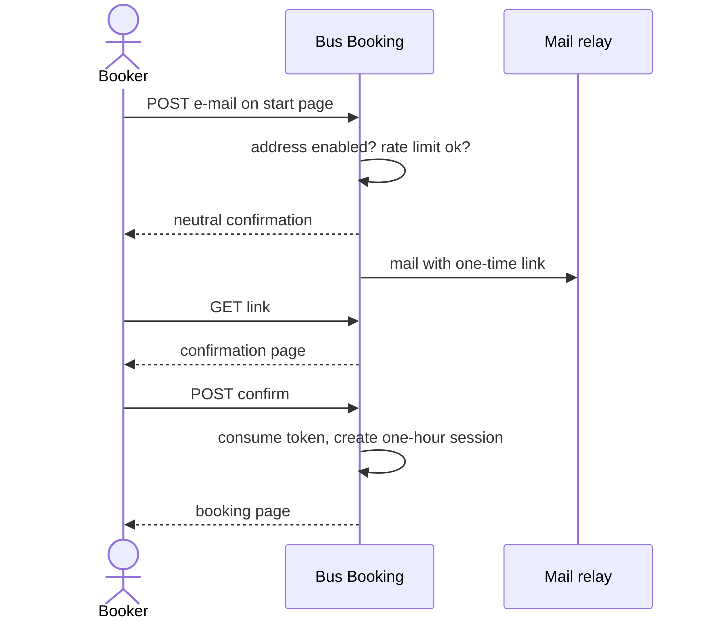
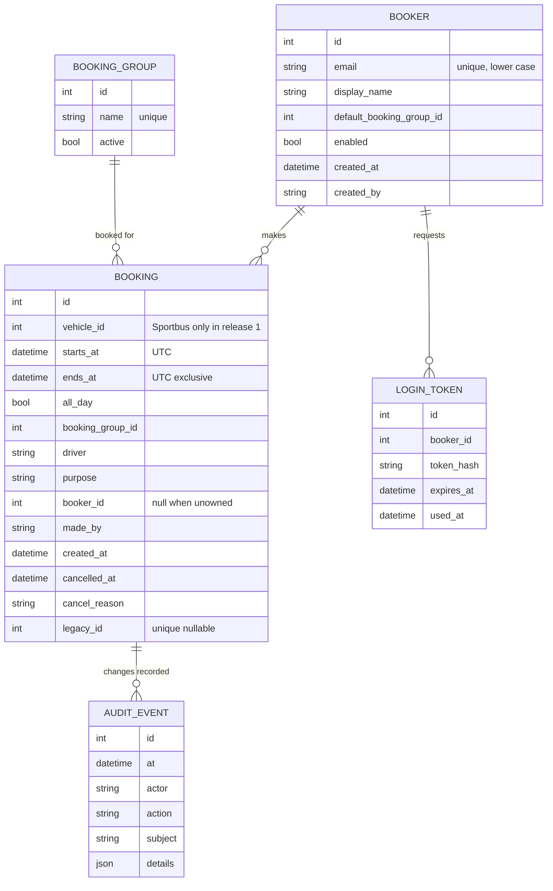

# Bus Booking: Product Requirements Document

- Status: reviewed; launch prerequisites outstanding
- Date: 2026-10-23
- Owner: Jan-Peter Alten
- Replaces: `CUSTOM_busregistrierung` and `CUSTOM_busliste`, the bus booking modules of the
  in-house CMS of TSV Blaichach (`turnen-blaichach`)

## 1. Summary

TSV Blaichach's Sportbus is shared by club sections and approved outside organizations, including
the school, municipality and youth house. The former booking feature ran in a PHP 7.4 CMS that has
been quarantined since 2026-10-21 and will not return.

Bus Booking is a standalone German web application. Its first release manages only the Sportbus.
Administrators enable booker e-mail addresses; enabled bookers use one-time links. Named
administrators authenticate with personal Authentik accounts. The application provides bookings,
conflict protection, a public occupancy plan, a calendar, management and notifications.

The public plan is on by default and exposes only date, time and Nutzergruppe. Public information
about keys and the Kreisjugendring fallback remains available independently of that plan. A later
second-vehicle capability is planned, subject to authority to manage the external vehicle.

## 2. Background

### 2.1 The old module

Evidence below comes from `jaypee-solutions/tk-cms` (`sites/turnen-blaichach`,
`src/cms/admin/modules/CUSTOM_busliste.php`) and the database dump of 2026-10-22. Details are in
`.okf/legacy-bus-module.md`. "Department" below describes the legacy field, not the new domain term.

- Bookings are rows of the CMS content table, linked to a hidden menu (id 127). Fields are
  reused: registrar name, driver (`keywords`), legacy department (`description`), purpose
  (`de_text`), booker id (`modules_data_1`), start and end (`gueltig_von`, `gueltig_bis`).
- Booking requires a CMS external-user login. Menu 126 is open to Trainer,
  Abteilungsleiter and Busreservierung groups. 20 users are in Busreservierung; 14 are online
  and have an e-mail address.
- Public page "Sportbus" (menu 125) explains where keys are and points to the Kreisjugendring bus
  as fallback. The public Belegungsplan lists all upcoming bookings, including driver and purpose.
- The dump contains 186 bookings, all starting in 2026 or later; 40 are current or future on
  2026-10-23. It contains seven distinct bookers and 16 department spellings.

### 2.2 Why now

The CMS cannot run on a supported PHP version without a port, which is not worthwhile for one
feature. The booking capability is needed for the winter season. Authentik is operated on the
existing infrastructure, but application-specific deployment resources must still be provisioned.

## 3. Goals and non-goals

### 3.1 Goals

1. Preserve booking, overlap protection, listing and cancellation while fixing legacy defects.
2. Let enabled e-mail addresses book without accounts; admins manage the allow-list.
3. Provide named administrators with Authentik-backed administration.
4. Reduce double bookings and phone calls through clear conflicts, calendar and confirmations.
5. Operate as a small service on existing infrastructure.
6. Migrate current and future bookings without losing occupied intervals or inventing ownership.
7. Provide a privacy-minimized public occupancy plan and public bus/key information.

### 3.2 Non-goals

- Payments, deposits, key handover workflows, mileage or fuel logs.
- More than the TSV Sportbus in the first release. A later second-vehicle capability is planned,
  gated on permission to manage the Kreisjugendring bus.
- Replacing the club website, self-registration, or native mobile applications.
- Booking approvals, duration or future-horizon limits, or per-booker quotas.
- Translation beyond German.

## 4. Users and roles

| Role | Who | Authentication | Can |
|---|---|---|---|
| Visitor | anybody | none | see public bus/key information and, while enabled, occupancy by date/time/Nutzergruppe |
| Booker | enabled e-mail address | one-time link; one-hour absolute session | book, see other occupancy only, see own retained booking details and history, edit/cancel own eligible bookings |
| Admin | nominated bus administrator/operator | personal Authentik account in `bus-booking-admins` | all retained booking details/history; administer bookers, Nutzergruppen, settings, content and audit |

Admins may book on behalf of others or without a booker address. The driver is not necessarily the
booker. A shared notification mailbox is not an administrator account. Legacy administrator IDs
1, 2 and 7 do not confer access. Admin names and Authentik subjects must be nominated before launch.

## 5. Baseline and parity

### 5.1 Behaviour to keep or clarify

| # | Legacy behaviour / decision | Source |
|---|---|---|
| P1 | Booking requires one Nutzergruppe, driver, purpose, start and end | `CUSTOM_busregistrierung` |
| P2 | Date input uses `DD.MM.YYYY`; omitted year means current year, two-digit year means 20xx | same |
| P3 | Missing end date means start date | same |
| P4 | Missing end time or explicit open end occupies through next local midnight; all-day is local midnight to next local midnight | same; clarified |
| P5 | Booker start must be strictly in the future at commit; admin may enter past corrections | same; corrected |
| P6 | Nutzergruppe, driver and purpose are required for ordinary bookings | same |
| P7 | Half-open intervals; touching bookings do not conflict | same; corrected |
| P8 | Upcoming active bookings are sorted by start and grouped by month | list code |
| P9 | Display all-day/open-end dates consistently with stored exclusive endpoint | list code; clarified |
| P10 | Owner may edit/cancel only before start; admins may correct/cancel at any time | same; clarified |
| P11 | Booking administrator is notified of creation, edit and cancellation | same |
| P12 | Booking and deletion changes are audited | same |
| P13 | Key-holder and Kreisjugendring information remains reachable on public start page | pages 270, 344 |
| P14 | Text is plain text; markup is escaped and not rendered | same |

### 5.2 Not parity-critical

CMS menu/template integration, the 2012 popup date picker and the legacy sender name are not
retained.

### 5.3 Defects found in the old module

These are not copied: unreliable past-date checks, closed-interval overlap checks, race conditions,
free-text group names, no editing, orphan rows after deletion, no booker confirmation, excess
personal data on the public page, absent CSRF/rate limits and module-parameter admin IDs.

## 6. Functional requirements

Priorities: M = required for first release; S = should follow; C = could follow. All UI, mail,
validation and errors are German.

### 6.1 Start page and login by one-time link

| ID | Req | Pri |
|---|---|---|
| FR-1 | Start page shows the bus/key and Kreisjugendring fallback information, editable by admins in-app with audit, plus link-request form | M |
| FR-2 | Same response body, status and similar response time for enabled, disabled and unknown addresses | M |
| FR-3 | Enabled address receives a link with a random token of at least 256 bits | M |
| FR-4 | Token is single-use, expires after 10 minutes, is stored only hashed; new request invalidates prior tokens for that address | M |
| FR-5 | GET displays confirmation; explicit POST consumes token, resisting mail scanners and link previews | M |
| FR-6 | Booker session expires exactly one hour after login; expiry requires a fresh link and never commits an expired submission | M |
| FR-7 | Limit link requests to 3/address and 10/client IP per 15 minutes; throttle failed token attempts | M |
| FR-8 | Logout ends the server-side session | M |
| FR-9 | German short mail states validity and what to do if unrequested | M |
| FR-10 | Disabling an address immediately revokes tokens and sessions; existing bookings remain | M |
| FR-11 | On expiry during form entry, preserve a browser-local draft for up to 24 hours across same-origin tabs. Reveal it only after reauthentication as the same booker; clear on logout, successful booking/edit or expiry. Require explicit review and resubmission; revalidate all fields and conflicts. Never store a login token in the draft. | M |

### 6.2 Booking

| ID | Req | Pri |
|---|---|---|
| FR-20 | Form has one active Nutzergruppe, free-text driver, multiline purpose, and date/time inputs. Driver defaults to booker's name when available. | M |
| FR-21 | Apply P2–P6 and defaults; inline German validation. Reject nonexistent or ambiguous explicit local times with guidance to choose an unambiguous time. | M |
| FR-22 | Check conflicts on half-open `[start, end)` intervals within one SQLite `BEGIN IMMEDIATE` transaction. Exact end/start touching is allowed; no buffer. | M |
| FR-23 | On conflict show conflicting interval and Nutzergruppe only; do not expose driver or purpose. Preserve form draft for correction. | M |
| FR-24 | For bookers, start must be strictly later than authoritative server time at commit. Admins may enter past corrections, still subject to conflict checking. | M |
| FR-26 | Preview weekly or fortnightly same-weekday series, ending by date or occurrence count. Show conflicts per occurrence; user chooses skip or abort. Save selected conflict-free instances atomically; stale conflicts abort the whole save for review. | S |
| FR-27 | Duplicate a booking as a template for a new booking | C |
| FR-28 | Notify configured booking-administrator recipient on create, edit and cancellation with trip details | M |
| FR-29 | Send the booking owner a German confirmation mail with trip details and a private `.ics` attachment after commit. | M |
| FR-30 | Enter/display Europe/Berlin local time and store instants in UTC with zone context. | M |
| FR-31 | Offer a same-duration next-free-slot suggestion after a conflict; it does not reserve the suggested interval. | S |

No approval state exists: a valid conflict-free booking is immediately confirmed and blocks the
interval. There are no club duration, horizon or per-booker limits. For admin-created bookings
without an owner, send no owner mail. Failed delivery does not undo a committed booking.

### 6.3 Plan and list

| ID | Req | Pri |
|---|---|---|
| FR-40 | Upcoming active list is sorted by start and grouped by month. Visitors see date/time/Nutzergruppe only; bookers see the same for others and full retained details for own bookings; admins see all retained details. | M |
| FR-41 | Switchable month and week calendar alongside the list, with the same role-based privacy as FR-40. | M |
| FR-42 | Mark own bookings; filter by Nutzergruppe and "only mine". | S |
| FR-43 | Bookers can filter to their own past bookings; admins can see all retained history. Other bookers' past bookings are not visible. | M |
| FR-44 | Revocable-token read-only `.ics` feed of upcoming active interval and Nutzergruppe only; no personal details, past or cancelled entries. | C |
| FR-45 | Public read-only plan, enabled by default, showing date/time/Nutzergruppe only; admin can disable it without disabling public start-page information. | M |
| FR-46 | Print-friendly view of the next 4 weeks | C |

Conflict details, calendar, list and feed must obey the same visibility restrictions. Anonymized
historical records retain only non-personal interval and Nutzergruppe information.

### 6.4 Editing and cancelling

| ID | Req | Pri |
|---|---|---|
| FR-50 | Bookers edit/cancel their own bookings only while start is later than now. Admins can edit/cancel any booking. | M |
| FR-51 | Cancellation requires confirmation and optional reason; retain as cancelled, hidden from occupancy. | M |
| FR-52 | Edit reruns conflict check; notify administrator with change details/diff. | M |
| FR-53 | When admin edits/cancels another booker's booking, enqueue German owner notice after commit. No mail to ownerless or erased identities. | M |
| FR-54 | A running or past booking can only be changed by admins; audit the correction. | M |

An expired-session submission does not write. Restore the local draft only after the same booker
reauthenticates (FR-11), then require reviewed, explicit resubmission.

### 6.5 Administration (Authentik)

| ID | Req | Pri |
|---|---|---|
| FR-60 | Personal-account Authentik OIDC authorization-code login with PKCE; admin role from `bus-booking-admins` group claim. | M |
| FR-61 | Users outside the group see "Kein Zugriff" and no admin data. | M |
| FR-62 | List/add/paste/enable/disable/delete bookers; fields include e-mail, display name, default Nutzergruppe, note and enabled state. | M |
| FR-63 | Disable immediately revokes access but retains future reservations. | M |
| FR-64 | Admins manage Nutzergruppen: seed the ten named groups; add/rename/deactivate. Rename changes historical display; deactivation prevents new selection but does not detach existing bookings. | M |
| FR-65 | Settings: notification recipient, sender and public-plan switch. No configurable limits. | M |
| FR-66 | Audit security and booking changes: actor, time, action and subject; apply §7 retention rules. | M |
| FR-67 | Admin-only CSV export for a chosen period, including retained details/status and cancellation reason; anonymized rows remain anonymized; audit exports. | S |
| FR-68 | Admin can book on behalf of a booker or for a driver/Nutzergruppe with no booker address. Unowned bookings are admin-managed unless verified owner is assigned. | M |
| FR-69 | Admin session follows Authentik session; logout ends local and Authentik sessions. Lifetime is configured in Authentik. | M |

Ordinary booker deletion is refused while retained bookings refer to that identity. A distinct
privacy-erasure procedure is specified in §7. A booking may be edited while retaining its inactive
Nutzergruppe; an inactive group cannot be newly selected or assigned by an edit.

### 6.6 Migration

| ID | Req | Pri |
|---|---|---|
| FR-70 | Import the 40 current/future bookings from the 2026-10-23 extract; normalize only explicitly reviewed Nutzergruppe mappings. | M |
| FR-71 | Import the 14 candidate enabled addresses from the old group for admin review; do not enable automatically. | M |
| FR-72 | Import earlier 146 rows as read-only history for statistics. | C |
| FR-73 | Import is idempotent using stable legacy booking IDs. Link ownership only through verified legacy-ID-to-email mapping; unmatched trips remain admin-managed and block occupancy. | M |

Produce a report of unmatched owners, unknown group spellings and overlapping imported active
bookings. Admins must resolve unknown groups and overlaps explicitly before cutover; never discard,
merge or admit a conflicting occupied trip silently.

## 7. Non-functional requirements

### 7.1 Security and privacy

- Tokens are random 256-bit values, hashed at rest, single-use and constant-time compared.
  Session cookies are Secure, HttpOnly, SameSite=Lax opaque IDs; server-side sessions rotate at
  login.
- Unknown/enabled address requests are indistinguishable to users. Logs do not expose full
  addresses; sending is daily-capped.
- Store/render plain text only. Enforce authorization and field minimization on all views and
  exports.
- Admin access is personal Authentik with MFA enforced there; no local password or shared login.
- OIDC, SMTP and session secrets come from environment configuration, never the repository.
- Privacy notice is linked on the start page. Personal data includes e-mail, names, driver,
  purpose and free-text cancellation reason.
- Three years after scheduled booking end, scrub booker reference/contact, driver, purpose,
  cancellation reason, `made_by`, and corresponding personal audit details/actor identifiers.
  Retain only interval, Nutzergruppe and non-personal action/time metadata for statistics.
  Applies to imported, active and cancelled trips. Standalone audit events are anonymized three
  years after event time; booking-linked events follow the booking's scheduled end.
- On verified erasure request, cancel future bookings, erase identity and personal free text from
  historical/cancelled bookings, retain only non-personal occupancy/statistics and minimal audit,
  and notify the bus administrator that slots were freed without personal details. This pathway
  overrides ordinary-delete refusal.
- Encrypted or host-protected rotating backups are retained at most 30 days. Do not claim
  immediate erasure from existing backups; restore must reapply erasures and retention cleanup
  before serving. Preserve erasure markers out-of-band across rollback.
- Locked dependencies, CI scanning and dependency updates are required.

### 7.2 Reliability and operations

- Intended deployment: one container behind Traefik on ax51, provisioned by a role in the AX41
  Ansible repository. No horizontal scaling; expected load is fewer than 10 requests/minute.
- SQLite WAL on persistent volume, single writer. Use `BEGIN IMMEDIATE` and overlap check to
  serialize booking writes.
- Nightly SQLite-safe backups; restore test before launch. Recovery objectives: one day recovery
  time and 24-hour recovery point.
- Health endpoint `/healthz`; structured logs to stdout. Logs must not bypass privacy retention.
- Mail outbox/retry; delivery state visible to admins. Mail failure does not block or roll back a
  booking.

### 7.3 Usability

- German only, `de-DE` dates, 24-hour clock, Monday week start.
- Responsive mobile and desktop browsers, including 360 px width. No kiosk or legacy-browser
  requirement.
- Keyboard-accessible labelled inputs and sufficient contrast; WCAG 2.2 AA target.
- A default booking takes at most four interactions after login.

### 7.4 Quality gates (project rules)

- Python 3.14, `uv`, ruff, pyright and pytest with the project coverage gate.
- Conventional commits; decisions are recorded in project knowledge.

## 8. Domain model

Rules:

- No active bookings of the same vehicle overlap: `starts_at < other.ends_at AND
  other.starts_at < ends_at`; exact touching is valid. Enforce in a serialized SQLite write
  transaction.
- Every booking has `ends_at > starts_at`. All-day spans successive Europe/Berlin local midnights,
  including 23- or 25-hour DST days, then converts to UTC.
- Missing end time, explicit "open end", and explicit 23:59 end all have exclusive endpoint at
  next local midnight. Display may say "open end"/23:59, but that day remains occupied up to
  midnight; next booking may start at midnight.
- Other explicit times are literal exclusive endpoints. Reject nonexistent spring-forward local
  times and ambiguous fall-back local times; never silently shift or choose an offset.
- Booker identity may be absent for admin-created bookings. Disabled/deleted identities do not
  detach existing records; deletion is blocked until references are resolved or erased.
- E-mail addresses are trimmed and case-insensitive. Cancelled bookings do not count for overlap.
- Seed Nutzergruppen: Fußball, Schule, Jugendhaus, Turnen, Gemeinde, Ski/Kanu, Tennis,
  Tischtennis, TSV and Vorstandschaft. A group is singular per booking.

## 9. Technical approach

| Area | Decision | Rationale |
|---|---|---|
| UI | NiceGUI on FastAPI; German copy | Small application, one language |
| Admin login | Authlib OIDC to Authentik, PKCE and group claim | Personal group-based access |
| Booker session | Server-side database session, opaque cookie | Immediate revocation on disable |
| Database | SQLite WAL on persistent volume; SQLAlchemy 2 and Alembic | Scale is small; write lock closes overlap race |
| Mail | SMTP via `mail.alten.de`, `aiosmtplib`, outbox and retry | Existing relay |
| Scheduling | In-process outbox/cleanup task | Single application process |
| Packaging | Template `Containerfile`, one image | Existing repository pattern |
| Deployment | AX41 Ansible role provisions service on ax51 behind Traefik | Deployment resources are external dependencies |
| Config | Environment parsed into one settings object | Keep secrets out of repository |

The package layout under `src/bus_booking/` separates domain rules, storage, auth, mail, UI,
application wiring and migration. This is intended design, not a claim that infrastructure has
already been deployed.

## 10. Migration and cutover

1. Provision deployment through AX41 Ansible, persistent SQLite volume, Traefik route,
   Authentik OIDC client and SMTP secrets.
2. Deploy at the production hostname and import FR-70/71/73 data; generate review report.
3. Admins review candidate addresses, group mappings, unmatched owners and conflicts. Resolve all
   unknown groups and conflicting active imports explicitly.
4. Verify personal Authentik admin roster, live mail/DNS, public information and backup restore.
5. Announce `https://bus.tsv-blaichach.de/` directly to bookers by e-mail. No old-site redirect or
   club-site link is a launch dependency.
6. Freeze old-module bookings at cutover; use the 2026-10-23 extract as baseline. Later entries
   must be explicitly reconciled.
7. Retain the old extract and local old-site copy as backup.

## 11. Success criteria

- P1–P14 rules have acceptance coverage, including interval endpoints, DST, past-start and
  privacy behavior.
- Concurrent same-slot requests result in at most one active booking.
- One-time links expire after 10 minutes, cannot be reused, and scanner GET does not consume them;
  enabled/unknown request responses are indistinguishable.
- Booker session expires absolutely at one hour; same-user draft restores only after reauthentication
  and requires explicit resubmission.
- Anonymous and other-booker views expose only date/time/Nutzergruppe; own history and admin
  details follow §4 permissions.
- Calendar and public occupancy plan are available on launch; public plan is enabled by default.
- Admin login requires a nominated personal Authentik account in the approved group.
- Imported occupied intervals remain represented; unknown groups and overlaps block cutover until
  explicitly resolved. Ownership is linked only by verified mapping.
- Before launch, verify sender alignment and delivery to real recipients; restore a backup and
  confirm retention/erasure cleanup is applied before restored service opens.
- Within the first month: zero double bookings; target at least 80% of bookings without a phone
  call to the administrator.

## 12. Milestones

| Milestone | Content |
|---|---|
| M0 | Skeleton, settings, health endpoint and container |
| M1 | Domain rules, SQLite storage, interval/DST rules and migration support |
| M2 | One-time links, sessions, draft recovery and mail outbox |
| M3 | Booking, list, calendar, public plan, edit and cancel |
| M4 | Authentik, booker/Nutzergruppe administration, on-behalf booking and audit |
| M5 | Import review, deployment, backup/restore and go-live prerequisite sign-off |
| M6 | Cutover; series, shared `.ics` feed and other S/C work follow |

## 13. Risks

| Risk | Impact | Mitigation |
|---|---|---|
| Club-domain mail fails SPF/DKIM/DMARC or lands in spam | Bookers cannot log in | Verify DNS authorization and real-recipient delivery before launch |
| Mail scanners consume tokens | Login fails | Confirmation page with explicit POST |
| Bookers call instead of using the service | Adoption | Direct announcement, concise instructions and QR code on the bus |
| Authentik group/client is misconfigured | No admin access | Verify nominated personal accounts and OIDC before launch |
| Legacy mappings are incomplete or conflict | Lost/incorrect occupancy | Review report; block cutover on unresolved groups/overlaps |
| Privacy erasure and backups diverge | Reintroduced personal data | Out-of-band erasure markers; replay cleanup before restore service |
| Scope expands to approvals or external vehicles | Delay and false expectations | Keep first release Sportbus-only and approval-free |

## 14. Go-live prerequisites

The PRD is reviewed, but launch readiness is not established. The product owner is responsible
for obtaining and recording evidence for each prerequisite below; do not infer that infrastructure
or credentials already exist.

1. Nominate the individual administrators and verify their personal Authentik account subjects
   and membership in `bus-booking-admins`. Legacy IDs 1, 2 and 7 are not sufficient.
2. Provision the `https://bus.tsv-blaichach.de/` DNS record and TLS/Traefik route through the AX41
   Ansible role.
3. Provision the Authentik OIDC client, callback configuration, group claim and required secrets.
4. Configure `bus@tsv-blaichach.de` through `mail.alten.de`; authorize SPF/DKIM as needed and
   verify alignment, DMARC behavior and delivery to actual recipients.
5. Obtain club-approved current key-holder contacts and Kreisjugendring fallback copy; enter and
   audit it in the application. Do not copy stale legacy text without review.
6. Review the ten seeded Nutzergruppen and explicitly approve all legacy spelling mappings and
   verified legacy user-ID-to-email mappings. Record unmatched owners.
7. Resolve every unknown group mapping and overlapping active imported booking; verify the
   resulting imported occupancy before cutover.
8. Provision persistent SQLite storage and protected nightly backups; demonstrate a restore and
   confirm retention cleanup and erasure markers are reapplied before service is opened.
9. Verify public plan default/privacy behavior, one-time login, session expiry, draft recovery,
   notifications, admin change mail and mobile/keyboard usability.
10. Notify bookers directly of the production URL and establish the old-module booking freeze and
    reconciliation procedure for entries after the extract.

